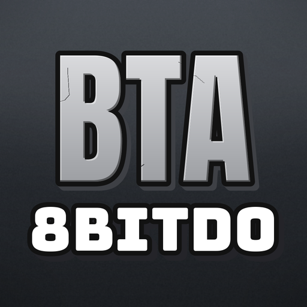
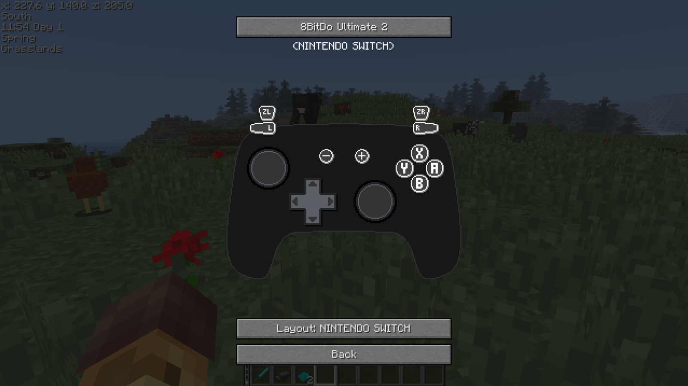

<p align="center">
  
</p>

# 8BitDo Controller Support

Makes every 8BitDo controller work with [Better than Adventure!](https://betterthanadventure.net/)
8.0.1's native controller support, without touching the game jar.

- Mod id: `eightbitdo` · package `pl.psampir.bta.eightbitdo` · version `1.0.1+8.0.1`
- Client-side only, Minecraft 8.0.1 (BTA) + Babric / Fabric loader
- Adds the missing GLFW controller mappings *and* a per-device button-layout toggle
- Licensed MIT; the bundled mapping data is SDL GameControllerDB data under the zlib license
- Source and releases: <https://github.com/psampir/bta-8bitdo> ·
  [Releases](https://github.com/psampir/bta-8bitdo/releases)
- Modrinth: [modrinth.com/mod/bta-8bitdo](https://modrinth.com/mod/bta-8bitdo) — draft, awaiting review

## The problem

BTA 8.0.1 implements controller support on top of **GLFW's gamepad API**. On start-up,
`net.minecraft.client.input.InputHandler.initGLFW(Minecraft)` reads the SDL
GameControllerDB snapshot shipped inside `bta-v8.0.1.jar` as `/controller_mappings.txt`,
feeds it to `glfwUpdateGamepadMappings()`, then counts the pads GLFW classifies as
gamepads and logs `"{} controllers found!"`.

GLFW only reports `glfwJoystickIsGamepad() == true` when a mapping matches the joystick's
**entire GUID**, and the GUID contains the device's firmware revision. An 8BitDo Ultimate 2
Wireless behind an 8BitDo UM 2 receiver, for example, reports

```
03000000c82d00000b31000000010000
```

while the snapshot only knows that product at revision `0x0114`
(`03000000c82d00000b31000014010000`). No exact match means no gamepad, so BTA logs
`0 controllers found!` and ignores the pad even though the kernel driver (`xpad`) works
fine and other SDL games see it.

## What the mod does

It registers the missing mapping **at runtime**, one line per attached 8BitDo pad, built
from the GUID the device actually reports:

```
03000000c82d00000b31000000010000,8BitDo Ultimate 2,a:b0,b:b1,...,x:b2,y:b3,
```

`glfwUpdateGamepadMappings()` is additive — BTA loading its own database afterwards does
not remove the extra entry — so the pad is already a gamepad when `initGLFW` counts
controllers, and BTA logs `1 controllers found!`.

Moving parts:

| Class | Role |
|---|---|
| `pl.psampir.bta.eightbitdo.MappingStore` | Parses the 8BitDo slice of SDL GameControllerDB, resolves a mapping for a live GUID (exact GUID → same bus/VID/PID → same VID/PID → XInput fallback). No Minecraft, LWJGL or SLF4J imports. |
| `pl.psampir.bta.eightbitdo.EightBitDoSupport` | Walks joysticks `0..GLFW_JOYSTICK_LAST`, skips non-8BitDo and already-known pads, feeds the resolved line to GLFW, remembers what it registered, and never lets an exception escape into the game. |
| `pl.psampir.bta.eightbitdo.LayoutConfig` | Reads and writes `config/eightbitdo.properties`: per-GUID, per-name and per-VID:PID button-layout overrides. JDK-only, so it is unit-tested outside the game. |
| `pl.psampir.bta.eightbitdo.mixin.InputHandlerMixin` | `@Inject` at `HEAD` of `InputHandler.initGLFW` (register before BTA counts) and of `InputHandler.poll` (rescan every 20 frames for hot-plug). |
| `pl.psampir.bta.eightbitdo.mixin.ControllerTypeMixin` | `@Inject` at `HEAD` of `ControllerType.fromController`, cancellable: returns the layout chosen in the config file instead of BTA's database entry. |
| `pl.psampir.bta.eightbitdo.mixin.ScreenControllerSetupMixin` | Adds the `Layout` button to the controller setup screen and recreates the controller input when the layout changes, so the new glyphs apply immediately. |

All three mixins use `remap = false`, because BTA ships unobfuscated classes.

GUID fields are decoded little-endian the way
`net.minecraft.client.input.glfw.GlfwGamepad` does it: bus in bytes 0-3, vendor id 4-5,
product id 8-9, firmware revision 12-13.

## Why a mod and not a jar patch

Patching `/controller_mappings.txt` inside `bta-v8.0.1.jar` would work for one pad and one
firmware revision, but it means shipping a modified 58 MB game jar, it breaks every time
BTA updates, and it still cannot handle a pad that is plugged in later or a revision the
static file does not contain. A Babric mod keeps the game jar pristine, applies to any
8BitDo pad whose GUID can be derived at runtime, and can be uninstalled by deleting one
file.

## Requirements

- A **Babric BTA 8.0.1 instance** — plain BTA 8.0.1 cannot load mods. Use
  `bta_fabric_instance_8.0.1.zip` from [Turnip-Labs](https://github.com/Turnip-Labs)
  (Fabric loader `0.18.4-bta.11`), either in Prism/MultiMC or by unpacking it and running
  its launcher.
- Java 17 or newer.
- The mod is client-side only: servers do not need it and cannot tell it is installed.

## Install

1. Build the jar (below) or take it from `build/libs/eightbitdo-1.0.1+8.0.1.jar`.
2. Drop it into the instance's `mods` folder:
   `.minecraft/mods/eightbitdo-1.0.1+8.0.1.jar` (Prism: right-click the instance →
   *Folder* → *Minecraft* → `mods`).
3. Start the game with the controller connected. The log should show

   ```
   [8BitDo/]: Registered controller mapping for "8BitDo Ultimate 2" (03000000c82d00000b31000000010000, SAME_BUS_VENDOR_PRODUCT), joystick id 8
   ...
   1 controllers found!
   ```

4. In *Options → Controls* the pad appears as `(UNKNOWN)`; that is expected. The controller
   setup screen also has a `Layout` button — pick `NINTENDO SWITCH` if your pad has a
   Switch-style ABXY shell (see below).

## In game



Verified on BTA 8.0.1 (Babric) with the 8BitDo Ultimate 2 Bluetooth in 2.4G/XInput mode on
2026-11-16: the pad is listed as `8BitDo Ultimate 2`, typed `(NINTENDO SWITCH)`, drawn with
the Switch glyphs B/A/Y/X, and the `Layout: NINTENDO SWITCH` button switches the glyph set
on the spot and persists the choice in `config/eightbitdo.properties`.

## The `(UNKNOWN)` label

BTA asks its own `ControllerTypeDatabase` for a display name and glyph set. Our pad is not
in that table, so the controller is labelled `(UNKNOWN)`. This is cosmetic: BTA's `UNKNOWN`
controller type already uses the **XBOX layout and the `xbox_360` glyphs**, so buttons,
sticks, triggers and the on-screen prompts all behave like an Xbox pad.

If your pad has a Switch-style ABXY shell, set its layout to `switch` — see below. The
button added by this mod does that without a second mixin into `ControllerTypeDatabase`.

## Button layouts (ABXY shells)

8BitDo sells the same electronics with two different face-button shells:

| Xbox shell | Switch shell | Physical positions |
|---|---|---|
| `A` bottom, `B` right, `X` left, `Y` top | `B` bottom, `A` right, `Y` left, `X` top | same |

The hardware is identical, so **neither the USB ids nor the names can tell the variants
apart**. The families that ship in both shells are:

- Ultimate 2 Wireless / Ultimate 2 Bluetooth
- Ultimate 2C Wireless / Ultimate 2C Bluetooth
- Ultimate C Wireless / Ultimate C Bluetooth
- Ultimate 2.4G / Ultimate Bluetooth

Each pair shares one USB product id — `310b` for the Ultimate 2 / Ultimate 2C line, `3106`
for the Ultimate C / Ultimate 2.4G line — and usually the same GLFW name, because that name
comes from the mapping database. Auto-detection is therefore impossible and the layout is a
manual, per-device choice; the mod ships with `AUTO` for every pad.

### The Layout button

BTA's controller setup screen (the one with the pad diagram, opened from *Options →
Controller... → Select Controller...*) gets an extra button at the bottom:

```
Layout: AUTO (UNKNOWN)
```

It acts on the selected controller and cycles

```
AUTO  ->  XBOX 360  ->  NINTENDO SWITCH  ->  AUTO
```

- `AUTO` shows the effective type in brackets and hands the pad back to BTA's database
  (`UNKNOWN`, which draws Xbox glyphs, for most 8BitDo pads).
- `XBOX 360` forces `xbox_360`.
- `NINTENDO SWITCH` forces `switch` — the right choice for a Switch-shell pad, because
  BTA's `switch.png` draws `B/A/Y/X` exactly where the shell has them, with no
  `controllerSwapAB/XY` setting needed.

Each click writes the choice to the config file and recreates the controller input, so the
glyphs change on the spot. The button is hidden while no controller is selected; the
controller-select button above it and *Back* keep working as before.

Only these three values are in the cycle on purpose: PS4/PS5/Steam layouts exist in the
config file for completeness but are not something you toggle by accident.

If you previously enabled BTA's *Swap A & B* or *Swap X & Y* options to make an Xbox glyph
set fit a Switch shell, turn them off when you pick `NINTENDO SWITCH`: those options swap
the **input**, while the layout only fixes the **labels**, so together they cancel out.

### The config file

`config/eightbitdo.properties`, next to `options.txt` in the instance's `minecraft/`
folder:

```properties
# exact GLFW GUID (32 hex characters)
guid:03000000c82d00000b31000000010000 = switch
# vendor:product, hexadecimal
2dc8:310b = xbox_360
# case-insensitive substring of the controller name
name:Ultimate = switch
```

- Values: `auto`, `xbox_360`, `xbox_one`, `xinput`, `ps3`, `ps4`, `ps5`, `switch`,
  `steam`, `steam_deck`. Unknown values are ignored and reported in the log once.
- Precedence: `guid:` → `name:` → `vid:pid`. `guid = auto` stops the search, which lets
  one pad opt out of a broader `name:` or `vid:pid` rule.
- The file is created/rewritten by the Layout button (atomically, header included); you
  can also edit it by hand, and the button keeps your other lines and their spelling.
- Deleting a line, or setting `auto`, is always safe: it only changes which glyph set BTA
  draws.

**PlayStation note:** 8BitDo does not make pads with PlayStation symbols, so `ps3`, `ps4`
and `ps5` exist for real Sony controllers (and for anyone who prefers those glyphs); they
are config-only, not part of the button cycle.

None of this changes input: BTA reads buttons and axes by GLFW index and uses
`ControllerType` purely for labels and sprites. A wrong layout mislabels buttons, it never
remaps them.

## Hot-plug

`InputHandler.poll()` runs once per rendered frame, and `tick()` rescans every 20 calls
(a few times per second). Plug the pad in (or wake it) while the game is running and BTA
picks it up in the next poll, exactly like a pad it knew about from the start. Mappings
already registered are remembered, so nothing is re-registered or re-logged.

## Build

```fish
set -x JAVA_HOME ~/.var/app/org.prismlauncher.PrismLauncher/data/PrismLauncher/java/java-runtime-delta
./gradlew build -Dorg.gradle.java.installations.paths=\
$HOME/.var/app/org.prismlauncher.PrismLauncher/data/PrismLauncher/java/java-runtime-gamma
```

- Gradle 9.3.1 via the wrapper, Fabric Loom 1.15, Kotlin DSL.
- Java 21 runs Gradle, Java 17 compiles the mod (`java = 17` in `gradle/libs.versions.toml`).
  The `-Dorg.gradle.java.installations.paths` flag points Gradle at an existing JDK 17
  instead of downloading one; change it to your own JDK 17 if it differs.
- BTA 8.0.1 comes from `https://downloads.betterthanadventure.net/bta-client/release/v8.0.1/manifest.json`,
  so the first build needs network access (~60 MB) and the Minecraft client jar it lists.
- Output: `build/libs/eightbitdo-1.0.1+8.0.1.jar` (plus a `-sources` jar).

No refmap is generated because the mixins are `remap = false`; BTA ships unobfuscated
classes. The compiler checks the target classes and `tools/verify.fish` checks the method
names with `javap`, so a BTA rename fails before the game is launched.

## Verification harness

`tools/verify.fish` compiles `MappingStore`, `EightBitDoSupport` and `LayoutConfig` **with
no Minecraft on the classpath** against the same LWJGL 3.3.3 jars BTA uses (taken from
PrismLauncher's libraries), then runs two harnesses:

```fish
set -x JAVA_HOME ~/.var/app/org.prismlauncher.PrismLauncher/data/PrismLauncher/java/java-runtime-delta
tools/verify.fish
```

Without `JAVA_HOME` the script falls back to the Temurin JDKs in PrismLauncher's flatpak
data directory, so on this machine it also runs as plain `tools/verify.fish`.

`tools/VerifyLayout.java` exercises `LayoutConfig` on temporary files: comments, key/value
case-insensitivity, precedence (`guid:` → `name:` → `vid:pid`), the `auto` opt-out, invalid
entries being ignored with warnings, `setGuid`/`save` round-trips and removal. It prints one
line per check.

`tools/VerifyMappings.java` prints every joystick GLFW sees, the resolved mapping (`kind`,
name, body and complete mapping line), the gamepad state readback, and calls
`registerMissingGamepads()` a second time to prove nothing is registered twice. It also
feeds BTA's whole bundled database to GLFW afterwards to prove the extra mapping survives
(the order `InputHandler.initGLFW` actually uses) — when `BTA_JAR` points at the instance's
`bta-v8.0.1.jar`.

Before either harness runs, `javap` inspects that jar and fails if `InputHandler.initGLFW`/
`poll`, `ControllerType.fromController(GlfwGamepad)` or `ScreenControllerSetup.init`/`tick`
no longer exist, so a BTA update that renames a mixin target fails in `tools/verify.fish`
instead of at runtime.

Exit codes: `0` pass, `1` assertion failed, `2` GLFW failed to start, `3` no 8BitDo pad
attached. Compiled classes go to `tools/build/` and are gitignored.

The harness needs `DISPLAY` or `WAYLAND_DISPLAY` (GLFW initialises a display connection
even though no window is created). SLF4J has no provider on the harness classpath, so the
mod's log lines are silenced there; the harness prints the same information itself.

## Mapping data

`src/main/resources/eightbitdo-mappings.txt` is generated, not hand-written:

```fish
java tools/GenerateMappings.java \
    <SDL_GameControllerDB snapshot>.txt \
    "/path/to/bta-v8.0.1.jar" \
    src/main/resources/eightbitdo-mappings.txt
```

It merges the upstream [SDL_GameControllerDB](https://github.com/mdqinc/SDL_GameControllerDB)
with the snapshot bundled in BTA 8.0.1, keeps only entries whose USB vendor id is `0x2dc8`
(8BitDo) and deduplicates by GUID. That is 210 entries today, 72 of them `platform:Linux`.
A newer snapshot can be regenerated at any time and dropped in without touching code.

Resolution at runtime, in order:

1. exact GUID match;
2. same bus + vendor + product, preferring `platform:Linux`, then the same firmware
   revision;
3. same vendor + product, same preference;
4. a hard-coded standard XInput body, so a brand-new 8BitDo pad whose GUID appears nowhere
   still works.

Only pads whose GUID vendor id is `0x2dc8` are touched; every other controller is left
exactly as BTA/GLFW configured it. Joysticks with fewer than two axes are skipped as well:
the UM 2 receiver, for instance, also exposes its keyboard and mouse HID interfaces as
single-axis "joysticks", and GLFW never accepts those as gamepads. A mapping is only
counted as registered once `glfwJoystickIsGamepad()` actually returns true for the device.

## Limitations

- The mixins hook BTA internals: `InputHandler.initGLFW`/`poll`,
  `ControllerType.fromController` and `ScreenControllerSetup.init`/`tick`. A BTA version
  that renames or restructures them fails fast — `tools/verify.fish` checks the targets with
  `javap`, the build breaks on a missing class, and a runtime mismatch makes Mixin log an
  injection error. Nothing else in BTA is modified.
- The button layout is a manual choice. Pads that share an id but not a shell cannot be
  detected, so a pad that is plugged into a different instance keeps whatever rule matches
  there; the `Layout` button and `config/eightbitdo.properties` are the only way to tell
  them apart.
- Mappings are a snapshot of SDL's database plus BTA's. A pad (or revision) absent from
  both falls back to the generic XInput body, which is right for pads in XInput mode but
  cannot invent bindings for exotic layouts (arcade sticks, N64 pads, paddles).
- Only 8BitDo hardware (vendor `0x2dc8`) is handled. Other 8BitDo-labelled devices that
  report a different vendor id are ignored, and so are the many non-8BitDo pads in the same
  database.
- Layout overrides only change labels and sprites. A wrong override mislabels buttons; it
  never remaps them, and it is always undone by cycling back to `AUTO`.
- The `platform:` field is only used to prefer Linux entries; GLFW itself ignores it, so it
  is stripped from the line handed to GLFW.

## Tested with

- BTA 8.0.1, fabric-loader `0.18.4-bta.11`, LWJGL 3.3.3 (the GLFW native bundled by
  LWJGL reports itself as 3.4.0-dev).
- 8BitDo Ultimate 2 Bluetooth in 2.4G/XInput mode through an 8BitDo UM 2 Receiver, USB
  `2dc8:310b`, driver `xpad`, GUID `03000000c82d00000b31000000010000`.
- In game, 2026-11-16: the controller setup screen shows `8BitDo Ultimate 2`,
  `(NINTENDO SWITCH)`, the Switch glyphs B/A/Y/X and the `Layout: NINTENDO SWITCH` button;
  cycling the layout redraws the glyphs immediately and the choice survives a restart.
- `tools/verify.fish`: the pad goes from `isGamepad=false` to `isGamepad=true`, resolves
  as `SAME_BUS_VENDOR_PRODUCT` to the SDL `8BitDo Ultimate 2` mapping, keeps that mapping
  after BTA's own 594 KB database is loaded, and a second scan registers nothing.
- `tools/VerifyLayout.java`: 25 checks over the config parser, precedence, `auto`, saving,
  reloading and removal.

## Credits and license

- Mod code: MIT, see `LICENSE`.
- Controller mapping data: [SDL_GameControllerDB](https://github.com/mdqinc/SDL_GameControllerDB)
  (zlib license, Copyright (c) 1997-2024 Sam Lantinga), merged with the database bundled in
  BTA 8.0.1. The zlib notice is reproduced in `LICENSE` and at the top of
  `eightbitdo-mappings.txt`.
- Icon: artwork supplied by the project author — see [`docs/logo/`](docs/logo/).
  It is not the official 8BitDo wordmark.
- Project scaffold: [Turnip-Labs/bta-example-mod](https://github.com/Turnip-Labs/bta-example-mod)
  (branch `8.0`).

## Disclaimer

Not affiliated with 8BitDo or the Better than Adventure! team. "8BitDo" and "Better than
Adventure!" are used descriptively; all trademarks belong to their respective owners. The
icon is the project's own artwork, not official artwork.

