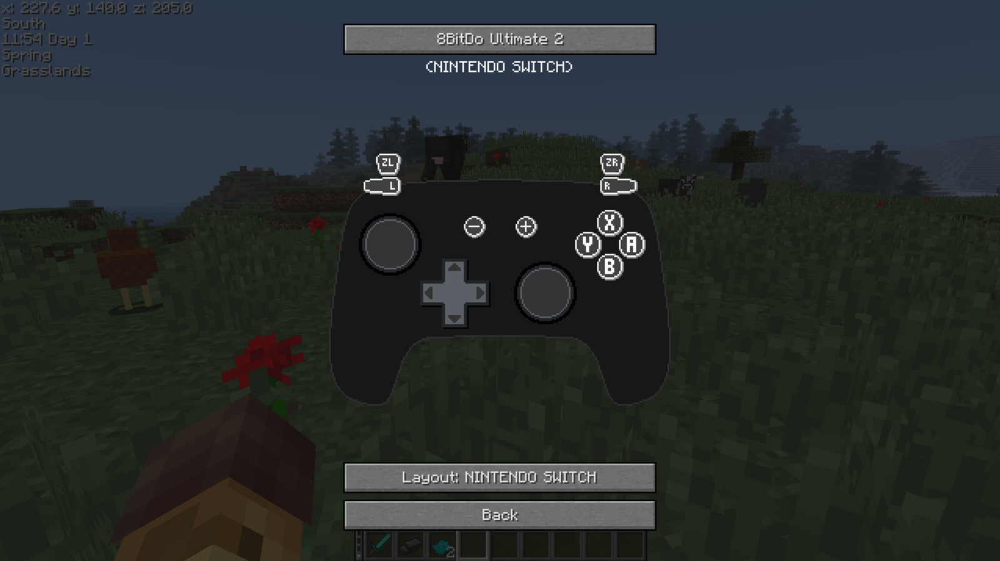

Makes every 8BitDo controller work with **Better than Adventure! 8.0.1**'s native controller support, and lets each pad draw the button glyphs that match its shell.



## The problem

BTA 8.0.1 implements controller support on top of GLFW's gamepad API. On start-up it feeds the SDL GameControllerDB snapshot inside `bta-v8.0.1.jar` to `glfwUpdateGamepadMappings()`, then counts the pads GLFW classifies as gamepads. GLFW only recognises a pad when a mapping matches its **whole GUID**, firmware revision included — so a pad missing from that snapshot, or running a different revision, is ignored and BTA logs `0 controllers found!`.

An 8BitDo Ultimate 2 on the 8BitDo UM 2 receiver, for example, reports `03000000c82d00000b31000000010000`, while the snapshot only knows that product at revision `0x0114`.

## What it does

- **Registers the missing mapping at runtime**, built from the GUID the device actually reports, before BTA counts controllers. The log then shows `1 controllers found!`.
- Ships **210 8BitDo entries** merged from [SDL_GameControllerDB](https://github.com/mdqinc/SDL_GameControllerDB) and BTA's own database, resolved by exact GUID → same bus/VID/PID → same VID/PID → a standard XInput fallback.
- **Per-device button layout toggle** in BTA's controller setup screen: `AUTO → XBOX 360 → NINTENDO SWITCH → AUTO`. It changes the glyphs BTA draws, never the input mapping.
- **Hot-plug**: a pad attached or woken after start is picked up within a few frames.

## Install

Requires a **Babric BTA 8.0.1** instance — plain BTA 8.0.1 cannot load mods. Use `bta_fabric_instance_8.0.1.zip` from [Turnip-Labs](https://github.com/Turnip-Labs) (fabric-loader `0.18.4-bta.11`) and Java 17+.

1. Drop `eightbitdo-1.0.0+8.0.1.jar` into the instance's `mods` folder.
2. Start the game with the controller connected. The log should show:

   ```
   [8BitDo/]: Registered controller mapping for "8BitDo Ultimate 2" (03000000c82d00000b31000000010000, SAME_BUS_VENDOR_PRODUCT), joystick id 8
   ...
   1 controllers found!
   ```

3. Open *Options → Controller... → Select Controller...*. The pad is listed as `8BitDo Ultimate 2` and typed `(UNKNOWN)` (Xbox glyphs); use the **Layout** button at the bottom to switch to `NINTENDO SWITCH` if your pad has a Switch-style ABXY shell.

Client-side only: servers do not need it and cannot tell it is installed.

## Button layouts (ABXY shells)

8BitDo sells the same electronics with two different face-button shells:

| Xbox shell | Switch shell |
|---|---|
| `A` bottom, `B` right, `X` left, `Y` top | `B` bottom, `A` right, `Y` left, `X` top |

The hardware is identical, so neither the USB ids nor the names can tell the variants apart. The families that ship in both shells are Ultimate 2 Wireless/Bluetooth, Ultimate 2C Wireless/Bluetooth, Ultimate C Wireless/Bluetooth and Ultimate 2.4G/Ultimate Bluetooth; each pair shares one USB product id (`310b` for the Ultimate 2 / 2C line, `3106` for the Ultimate C / 2.4G line). The layout is therefore a manual choice, `AUTO` by default.

BTA's `switch.png` draws `B/A/Y/X` exactly where the Switch shell has them, so `NINTENDO SWITCH` matches the shell with no input swap. If you previously enabled BTA's *Swap A & B* or *Swap X & Y* to compensate, turn them off: those swap input, the layout fixes labels.

## Configuration

The Layout button writes `config/eightbitdo.properties` in the instance's `minecraft/` folder:

```properties
# exact GLFW GUID (32 hex characters)
guid:03000000c82d00000b31000000010000 = switch
# vendor:product, hexadecimal
2dc8:310b = xbox_360
# case-insensitive substring of the controller name
name:Ultimate = switch
```

- Values: `auto`, `xbox_360`, `xbox_one`, `xinput`, `ps3`, `ps4`, `ps5`, `switch`, `steam`, `steam_deck`.
- Precedence: `guid:` → `name:` → `vid:pid`; `guid = auto` stops the search, so one pad can opt out of a broader rule.
- Unknown values are ignored and reported in the log once; the file can be edited by hand, and the button keeps your other lines.

`ps3`/`ps4`/`ps5` are config-only (8BitDo does not make PlayStation-symbol pads); they exist for real Sony controllers.

## Tested

BTA 8.0.1 (Babric), 8BitDo Ultimate 2 Bluetooth in 2.4G/XInput mode (`2dc8:310b`, GUID `03000000c82d00000b31000000010000`), 2026-11-16: the pad is listed as `8BitDo Ultimate 2`, typed `(NINTENDO SWITCH)`, drawn with the Switch glyphs B/A/Y/X, and the layout toggle applies immediately and persists across restarts. The offline harness (`tools/verify.fish`) passes against the real pad.

## Limitations

- The mod hooks BTA internals (`InputHandler.initGLFW`/`poll`, `ControllerType.fromController`, `ScreenControllerSetup.init`/`tick`). A future BTA update may need matching changes; a verification script checks the targets.
- The button layout is a manual choice, because pads that share a USB id but ship different shells cannot be detected.
- Only devices reporting USB vendor `0x2dc8` (8BitDo) are touched; other controllers keep whatever BTA/GLFW configured.
- A layout override only changes labels and sprites. A wrong override mislabels buttons, it never remaps them.

## Credits

- Mod code: MIT. Controller mapping data: SDL_GameControllerDB (zlib license, Copyright (c) 1997-2024 Sam Lantinga), merged with the database bundled in BTA 8.0.1.
- Icon: original artwork typeset from the OFL fonts Anton and Bungee; not the official 8BitDo wordmark.

Not affiliated with 8BitDo or the Better than Adventure! team. "8BitDo" and "Better than Adventure!" are used descriptively; all trademarks belong to their respective owners.

Source, releases and build instructions: <https://github.com/psampir/bta-8bitdo>
